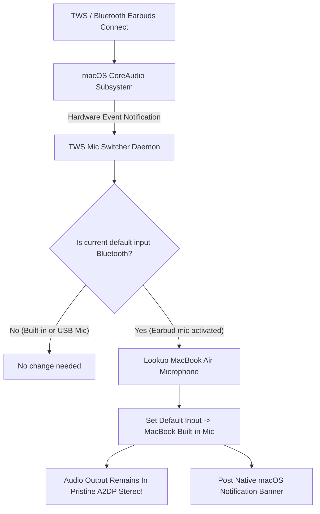

# 🎧 TWS Mic Switcher for macOS

A native, zero-dependency macOS background service that **automatically locks and switches your microphone input to your MacBook built-in microphone whenever your TWS (True Wireless Stereo) or Bluetooth headphones connect.**

---

## ⚡️ Quick Install (1-Line Command)

Run this command in Terminal to install and start the background daemon:

```bash
curl -fsSL https://raw.githubusercontent.com/whoavidwivedi/tws-mic-switcher/main/install.sh | bash
```

---

## 💡 Why This Feature Is Essential on macOS

When you connect any Bluetooth earbuds (OPPO, Sony, AirPods, Bose, Galaxy Buds, Nothing Ear, Jabra, etc.) to macOS:

1. **The Bluetooth Audio Quality Drop (HFP/SCO Profile):**
   macOS automatically sets both sound output and microphone input to the newly connected Bluetooth device. When any app (Zoom, Google Meet, Slack, Discord, FaceTime, Siri, or browser tabs) activates the microphone:
   - macOS drops Bluetooth from **high-bitrate stereo A2DP (AAC at 256–320 kbps)** to **two-way hands-free mode (16 kHz mono / 64 kbps)**.
   - Music, videos, system sounds, and call audio immediately sound muffled, robotic, and degraded.
2. **MacBook Air/Pro Microphone is Studio Quality:**
   MacBooks feature a studio-quality 3-microphone beamforming array with high signal-to-noise ratio that vastly outperforms micro-stem earbud microphones.

### The Solution:
By keeping default input locked to your MacBook built-in microphone:
- macOS **never switches Bluetooth to hands-free profile**.
- Your headphones stay in **pristine stereo A2DP (AAC)** audio output at all times.
- Your calls, meetings, and voice recordings use the studio-grade MacBook microphone.

---

## 🏗️ How It Works



- **Smart Auto-Switch on Connection:** Automatically keeps mic input on MacBook built-in mic during the initial TWS connection window.
- **Respects Manual User Selection:** If you manually choose your TWS microphone in Sound Settings / Control Center (e.g. to walk into another room), the daemon respects your choice and will **never** override it.
- **100% Silent & Non-Intrusive:** Operates completely silently in the background with zero desktop banners or notification interruptions.
- **100% Native & Zero-Dependency:** Written entirely in Swift using native macOS `CoreAudio.framework` and `AppKit.framework`.
- **Audio Output is Read-Only:** Audio output, output volume, mute status, and stereo channels are strictly read-only and never modified.
- **Zero Polling (0.0% CPU):** Pure event-driven CoreAudio HAL property listeners. Wakes for ~5ms on device connect and sleeps completely otherwise.
- **USB Mic Friendly:** Dedicated USB microphones (e.g. Blue Yeti, Shure, Rode) are never overridden.

---

## 🚀 CLI Commands

```bash
# Check current audio routing and switcher status
tws-mic-switcher status

# Manually force switch default input to MacBook Mic now
tws-mic-switcher switch

# Run with an optional visual Menu Bar icon (with toggles & status)
tws-mic-switcher menubar

# Toggle desktop notification banners
tws-mic-switcher notify off
tws-mic-switcher notify on

# Test the custom notification banner
tws-mic-switcher test-notify

# Temporarily pause / re-enable auto-switching
tws-mic-switcher disable
tws-mic-switcher enable

# Tail live logs
tail -f ~/Library/Logs/tws-mic-switcher.log
```

---

## 🛑 Uninstallation

To completely stop and remove the LaunchAgent service:

```bash
curl -fsSL https://raw.githubusercontent.com/whoavidwivedi/tws-mic-switcher/main/uninstall.sh | bash
```

Or from local clone:
```bash
./uninstall.sh
```

---

## 📄 License

MIT License. Free and open source for everyone.
